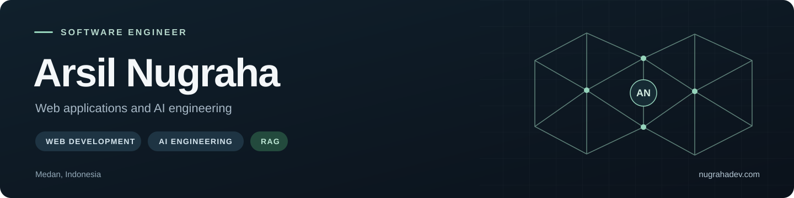

  

  <a href="https://nugrahadev.com"><strong>Portfolio</strong></a>
  &nbsp; · &nbsp;
  <a href="https://www.linkedin.com/in/arsilnugraha/">LinkedIn</a>
  &nbsp; · &nbsp;
  <a href="https://nugrahadev.com/CV_Arsil_Nugraha_ATS_Updated.pdf">View CV</a>
  &nbsp; · &nbsp;
  <a href="mailto:nugrahaarsil@gmail.com">Email</a>

## About

I'm **Arsil Nugraha**, a software engineer based in **Medan, Indonesia**. I build web applications and work with **machine learning and retrieval-augmented generation (RAG)**.

## Technology

| Area | Technologies |
| :--- | :--- |
| Frontend and mobile | Next.js, React, Vue.js, React Native, HTML, CSS |
| Backend | Laravel, Livewire, CodeIgniter, Express.js, Flask, REST APIs |
| AI engineering | RAG, Machine Learning, PyTorch, Python |
| Data and development tools | Supabase, SQL, Git, Docker, MQTT |
| Languages | JavaScript, PHP, Python, Java, SQL |
